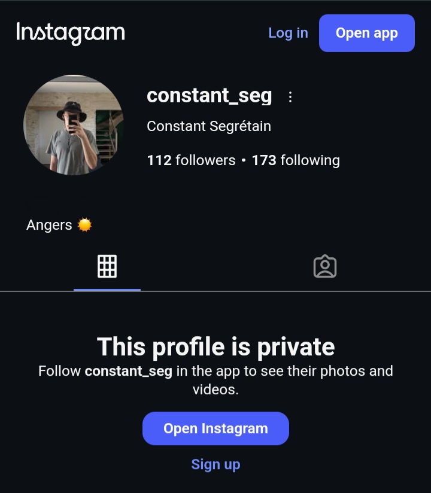
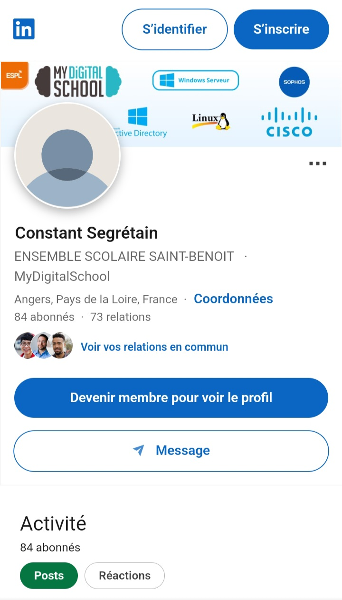

# Welcome To Dexter's Laboratory

***You know what time it is.***

## How about that? Sometimes the curtains really do match the drapes
- Realizing that there might be a common thread given the recent impersonation of and name jacking of my application, combined with the timely creation of user handles containing my full legal name, coinciding precisely with the creation of this github account and initial release, I decided to hire a private investigator and procure a background check on this individual.
- Brace yourself, take a seat, or whatever you'd prefer to call it. Or hit the back button, this is some gruesome stuff.

## Want your portfolio to be on public display? My pleasure.

- That black hat you're wearing, do yourself a favor and replace it with a propeller, except you're not going anywhere.
- We traced your real identity. As it turns out, this is individual has a fairly recent record, and quite a repulsive one at that.
- During covid this individual was arrested on some of the most appalling of charges, however was given a break due to the initial report being filed by a family member whom later did not wish to take it to trial.
- ***Meet the "babysitter" from hell.*** Imagine entrusting a family member to watch over your baby, and then this happens. Absolutely horrendous. It doesn't get any worse than this, or does it?
- Possession of child exploitation materials. It doesn't really need further elaboration to get the point across, just an overall disgusting individual.

